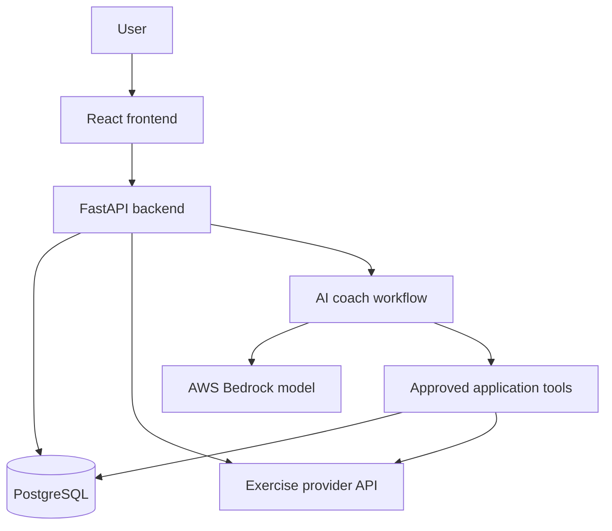

# 🏋️ UNShaken Smart Coach

**An AI-powered fitness coach for personalized workout and meal planning.**

UNShaken Smart Coach is a collaborative learning project built by participants in an AI engineering class. We are building a practical application while learning frontend development, backend APIs, databases, agentic AI, cloud services, and observability.

Our goal is to help users build fitness routines that fit their goals, experience, equipment, schedule, and dietary preferences.

> **Project status: Planning and foundation.** This repository currently contains documentation and a starter `.gitignore`. The features, architecture, and roadmap below describe the intended direction. Application code, runnable setup instructions, automated checks, and deployment workflows will be added through the backlog.

## 📑 Contents

- [Product vision](#-product-vision)
- [Planned features and roadmap](#-planned-features-and-roadmap)
- [Planned technology stack](#-planned-technology-stack)
- [Proposed architecture](#-proposed-architecture)
- [How the AI coach will work](#-how-the-ai-coach-will-work)
- [Observability with Grafana](#-observability-with-grafana)
- [Getting started](#-getting-started)
- [Team workflow and backlog](#-team-workflow-and-backlog)
- [Testing and definition of done](#-testing-and-definition-of-done)
- [Security, privacy, and costs](#-security-privacy-and-costs)
- [Communication and learning](#-communication-and-learning)
- [Open decisions](#-open-decisions)
- [Intended use and license](#-intended-use-and-license)

## 🎯 Product Vision

A useful fitness coach should understand the person before suggesting a plan.

We plan to collect relevant information such as:

- Fitness goals, such as building strength or improving general fitness.
- Fitness experience and current activity level.
- Body weight, using an explicit unit such as kg or lb.
- Available equipment and whether the user trains at home or in a gym.
- Available days and time per session.
- Exercise preferences and relevant limitations.
- Dietary preferences, restrictions, and allergies for meal planning.

Users should be able to review, edit, and approve suggested plans. Body weight alone will not be treated as enough information to create a suitable plan.

### Example user journey

1. A user describes their goals and available equipment.
2. The coach asks for any missing information needed to build a plan.
3. The application retrieves relevant exercise details from the selected exercise provider.
4. The coach suggests a workout schedule with exercises, sets, reps, and rest guidance.
5. The user reviews and saves the plan.
6. The user records completed workouts and views progress.
7. A later release adds meal suggestions based on dietary needs and preferences.

## ✨ Planned Features and Roadmap

All items below are planned, not claims of completed functionality. Delivery order may change as the team learns and agrees on requirements.

| Stage | Focus | Expected outcome |
|---|---|---|
| 1. Foundation | Agree on scope, data model, API contracts, and local setup | A shared starting point that contributors can run |
| 2. Core workout app | Exercise browsing, equipment filters, workout plans, and session tracking | A working fitness application using sample data |
| 3. AI workout coach | User intake, tool calling, structured plan generation, and evaluations | A coach that proposes workout plans users can review |
| 4. Nutrition support | Dietary intake and meal suggestions | Meal planning with explicit restriction and allergy checks |
| 5. Deployment and improvements | Cloud deployment, automation, reliability, and progress-based adjustments | A more complete application supported by operational feedback |

Observability, security, and testing will be introduced as features are built.

### Core workout scope

- Browse exercises and filter by relevant attributes.
- Retrieve exercise details through an external provider.
- Create and edit workout plans.
- Record completed sets, reps, and optional weight.
- View workout history and basic progress.
- Support sample profiles during initial development.

### AI and nutrition scope

- Ask follow-up questions when important information is missing.
- Use approved tools to retrieve exercise data and relevant stored preferences.
- Generate structured plans that the application can validate.
- Explain why exercises or meals were suggested.
- Allow users to request changes and approve a plan before saving.
- Check dietary restrictions and allergies explicitly.
- Handle unavailable models, missing data, and provider errors clearly.

Account registration, authentication, and access controls will need their own agreed design before real personal profiles are supported.

## 🛠️ Planned Technology Stack

| Area | Planned technology | What we will learn |
|---|---|---|
| Frontend | React + TypeScript | Components, forms, API calls, and responsive screens |
| Backend | Python + FastAPI | API design, validation, error handling, and service integration |
| Database | PostgreSQL | Data modeling, migrations, queries, and data integrity |
| Exercise data | External fitness API, provider to be selected | Authentication, quotas, error handling, and data mapping |
| LLM access | AWS Bedrock initially; alternatives may be evaluated | Model integration, structured output, latency, and usage tracking |
| Agent framework | To be selected | Tool calling, conversation state, and controlled agent workflows |
| Telemetry | OpenTelemetry | Application instrumentation and request correlation |
| Dashboards | Grafana | Visualizing performance, errors, and AI activity |
| Telemetry storage | Prometheus, Loki, and Tempo under evaluation | Metrics, logs, and distributed traces |
| Packaging | Docker; local Compose setup planned | Consistent local services and configuration |
| Automation | GitHub Actions | Automated checks and an eventual deployment workflow |
| Collaboration | GitHub Issues, Projects, and pull requests | Backlog planning, ownership, and code review |

These choices describe the intended learning path. Versions, supporting libraries, cloud hosting services, and the final deployment design are not yet selected.

## 🧭 Proposed Architecture

The frontend will call FastAPI. The backend will manage database access, external API calls, and AI interactions. Provider credentials will remain on the backend.



### Proposed component responsibilities

- **React:** Collect preferences, display exercises, show plans, and record workout activity.
- **FastAPI:** Validate input, apply application rules, and expose agreed API contracts.
- **PostgreSQL:** Store application records and enforce data relationships.
- **Exercise integration:** Translate provider responses into an internal exercise format.
- **AI coach:** Gather context, choose approved tools, and propose plans.
- **Observability:** Help contributors understand errors, performance, and request flow.

The database should remain the source of truth for saved plans and workout records. The AI coach should use defined application tools instead of receiving unrestricted database access.

### Proposed repository layout

The following folders are a proposal and do not exist yet:

| Path | Intended purpose |
|---|---|
| `frontend/` | React application |
| `backend/` | FastAPI application and AI integration |
| `docs/` | Architecture decisions, API contracts, and setup guides |
| `infra/` | Local services and deployment configuration |
| `observability/` | Collector configuration and Grafana dashboards |
| `.github/workflows/` | Automated checks and deployment workflows |

## 🤖 How the AI Coach Will Work

We want the coach to do more than return a generic chat response.

The proposed workflow is:

1. **Understand:** Collect the user's goals, experience, equipment, and schedule.
2. **Clarify:** Ask questions when the available information is insufficient.
3. **Retrieve:** Call approved tools for exercise details and relevant user context.
4. **Propose:** Produce a structured workout or meal plan.
5. **Validate:** Check required fields, application constraints, and restrictions.
6. **Review:** Present the suggestion for user approval before saving.

### Planned AI evaluation cases

- The user has no gym equipment.
- The user only has time for short sessions.
- Required information is missing or contradictory.
- The exercise provider times out or returns incomplete data.
- A model response contains invalid or unsupported fields.
- A meal suggestion conflicts with a declared restriction or allergy.
- A request contains instructions that attempt to bypass application rules.

The agent framework and evaluation tooling will be selected through a small proof of concept. We will compare complexity, model compatibility, testability, and cost.

## 📊 Observability with Grafana

Observability will help us answer practical questions:

- Which requests are failing?
- Which endpoint or external provider is slow?
- How long does an AI plan take to generate?
- Which tool calls fail most often?
- Can we follow a request from the backend through its dependencies?

### Planned signals

| Signal | Examples |
|---|---|
| Logs | Structured errors, operation results, and provider failures |
| Metrics | Request counts, error rates, response times, and model usage when available |
| Traces | Connected spans for API requests, database work, tool calls, and model calls |
| Dashboards | Application health, external dependency performance, and AI workflow activity |

OpenTelemetry will be used for instrumentation. Grafana will visualize the collected signals; compatible storage backends and collection services will be selected during implementation.

We will avoid logging raw prompts, dietary or health details, credentials, and other personal information. Logs and traces should use correlation identifiers that help troubleshoot without exposing user details.

## 🚀 Getting Started

### What you can do today

1. Read this README.
2. Join the team's Discord workspace.
3. Share your GitHub username in `#general`.
4. Request access to the shared GitHub Project board.
5. Pick an exploration topic or a small task and confirm ownership.

For local infrastructure setup, follow the guides in [`docs/setup/`](docs/setup/README.md).

No board or Discord invitation link is published here yet. Ask the project maintainer in Discord for access.

### Fork and clone

Fork this repository into your own GitHub account, then replace `YOUR_USERNAME` below:

```bash
git clone https://github.com/YOUR_USERNAME/unshaken-smart-coach.git
cd unshaken-smart-coach
git remote add upstream https://github.com/dhaval-mistry/unshaken-smart-coach.git
git switch -c feature/your-task-name
```

### Keep your fork up to date

Before starting new work, update your local `main` and push it to your fork:

```bash
git fetch upstream
git switch main
git merge --ff-only upstream/main
git push origin main
```

Start from a clean working tree. If the fast-forward fails because your local `main` has different commits, ask for help before rewriting history.

### Local application setup

There is no runnable frontend or backend application in this repository yet. A Docker Compose configuration is available for the local PostgreSQL database. Runtime versions, application dependencies, database migrations, seed data, and launch commands will be documented as the foundation is implemented.

Each participant will manage their own development environment, private configuration, and any cloud account they choose to use. The planned local setup should support sample data and mocked integrations so contributors can work without making paid model calls for every task.

A shared `.env.example` containing placeholders will be added when configuration names are agreed. Actual `.env` files and credentials must never be committed.

## 🤝 Team Workflow and Backlog

**Product backlog owner:** Dhaval Mistry.

This repository is the shared reference for accepted contributions. Participants develop in their own forks and propose changes through pull requests.

### Board workflow

| Status | Meaning |
|---|---|
| Backlog | Ideas and future work |
| Ready | Clear work that someone can pick up |
| In progress | Work currently being implemented |
| Review | A pull request is ready for review and verification |
| Done | The agreed completion criteria are met and changes are merged |

### Task ownership

- Each story has one owner and, where possible, a reviewer or learning partner.
- Start with one active task per person.
- Split larger stories into smaller tasks that can be reviewed independently.
- Confirm API contracts and dependencies before building connected features.
- Ask for support early if a task is unclear or blocked.
- Everyone can help, but changes to scope should be agreed in the backlog.

### What a good story includes

- The user outcome or problem.
- Scope and relevant dependencies.
- Clear acceptance criteria.
- An owner and reviewer.
- Expected validation and any API or data model changes.

**Example story:** A user can filter exercises by available equipment.

**Example acceptance criteria:**

- Choosing an equipment type returns matching exercises.
- Clearing the filter restores the unfiltered list.
- No results produces a clear empty state.
- Provider failures produce a useful error without exposing credentials.
- Filtering behavior has appropriate automated checks.

### Pull request process

1. Confirm the task you are working on.
2. Create a short-lived branch, such as `feature/exercise-filter`, `fix/empty-results`, or `docs/local-setup`.
3. Implement the change and run the relevant checks.
4. Push the branch to your fork.
5. Open a pull request targeting this repository's `main` branch.
6. Link the issue and explain what changed, how it was verified, and any limitations.
7. Request review and update the board to Review.
8. Address feedback before the maintainer merges the change.

Avoid pushing feature work directly to `main`. Review and merge permissions will depend on repository configuration.

AI coding agents are welcome. Contributors remain responsible for understanding, reviewing, and testing the code they submit.

## ✅ Testing and Definition of Done

Testing tools and commands will be documented when the implementation is available.

Planned validation includes:

- Backend input validation, application rules, and database behavior.
- Frontend forms, loading states, empty states, and error handling.
- Mocked external API and model calls for repeatable, low-cost tests.
- Integration checks for connected components.
- AI evaluations for plan quality, missing information, and restriction handling.

A task is Done when:

- Its acceptance criteria are satisfied.
- Relevant checks pass.
- Another contributor or maintainer has reviewed it.
- Documentation is updated where behavior or setup changed.
- No credentials or personal data are included.
- The change is merged into the shared reference repository.

## 🔐 Security, Privacy, and Costs

- Keep provider credentials on the backend, never in browser-delivered code.
- Use synthetic profiles and sample data during development.
- Never commit `.env` files, access tokens, database passwords, or cloud credentials.
- Use limited cloud permissions and enable account protection.
- Set budget alerts and check provider usage. Budget alerts are notifications, not guaranteed spending limits.
- Discuss paid dependencies with the team before making them part of the shared setup.
- Check exercise API terms, quotas, attribution requirements, and redistribution rules before selecting a provider.
- Restrict AI tools to explicitly approved operations.
- Require user approval before saving or replacing a proposed plan.
- Add appropriate authentication, authorization, and privacy controls before supporting real users.

Free collaboration tools do not make model inference, external APIs, or cloud hosting automatically free. Each participant is responsible for charges in their own accounts.

## 💬 Communication and Learning

| Discord channel | Purpose |
|---|---|
| `#start-here` | Project overview, team guidelines, and important links |
| `#announcements` | Important updates and milestones |
| `#general` | Introductions and GitHub usernames |
| `#build-and-help` | Technical questions, blockers, and task discussions |
| `#progress-and-demos` | Progress, pull requests, screenshots, and demos |
| `#learn-together` | Topics needed for upcoming requirements and features |
| `#side-quests` | Optional small projects and practice challenges |

These are the agreed channel names to use as the workspace is set up.

Be kind, ask questions, explain your suggestions, and respect different schedules and skill levels. Helping someone understand a problem is a valuable contribution.

For progress updates, keep it simple:

> Completed: … | Next: … | Help needed: …

Side quests are optional. Work required for the main product belongs in the shared backlog.

## ❓ Open Decisions

The following choices still need team agreement:

- Exercise API provider and permitted use of its data.
- Agent framework and initial model.
- Supported runtime versions and dependency management.
- Profile, authentication, and authorization design.
- Database schema and migration tooling.
- Deployment target and expected monthly budget.
- Final telemetry storage and collection setup.
- Meal data source and nutrition validation approach.
- Open-source license.

Record decisions in the backlog and, as the project grows, in architecture notes under `docs/`.

## 📝 Intended Use and License

UNShaken Smart Coach is a learning project for general fitness and nutrition guidance. It is not a substitute for advice from a qualified healthcare professional, registered dietitian, or personal trainer.

A license has not been selected for this repository yet. Do not assume unrestricted reuse or redistribution rights from the repository being publicly accessible.

---

**Learn together. Build useful things. Help each other grow. 💪**
