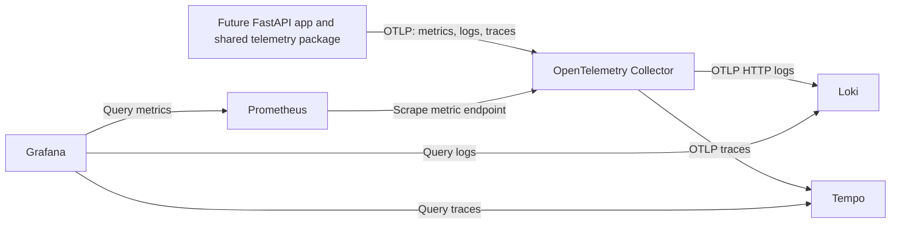

# Local observability design

Status: **PROPOSED FOR HUMAN REVIEW**. No services, instrumentation, or
configuration are implemented by this document.

## Repository baseline

The repository currently contains design/setup documents, reusable agent
definitions, their synchronization script and tests, UI reference images, and
a root Compose file with PostgreSQL 17. There is no backend/frontend application,
telemetry package, or observability stack yet. The database schema is still a
design; do not assume application operations already exist.

This proposal follows the README's OpenTelemetry/Grafana direction and the
Developer role's shared telemetry requirement. Existing database decisions and
the PostgreSQL service are unchanged.

## Purpose and scope

Help contributors answer: Is the app working? Which operation failed? Where did
time go? Can we follow one operation through its dependencies?

| Component | Responsibility |
|---|---|
| OpenTelemetry Collector | Receive, filter, batch and route application telemetry |
| Prometheus | Collect/store metrics: counts, errors, durations |
| Loki | Store/search structured application logs |
| Tempo | Store/search traces: connected steps in an operation |
| Grafana | Query the three stores and display dashboards |

Recommendation: use these local open-source components first. Defer Mimir,
cloud hosting, alerts/notifications, high availability, and frontend telemetry.
PostgreSQL stores application records, not logs, metrics, or traces. Grafana
uses its own local data volume; do not couple it to the application's database.

## Signal flow



OTLP is OpenTelemetry's transport protocol. Send all three signals to one
Collector rather than configuring separate exporters in each business module.

Metrics: the Collector exposes received application metrics on an internal
Prometheus exporter endpoint, proposed port 8889. Prometheus scrapes it. Keep
Collector self-monitoring metrics separate; they do not prove the application
is instrumented. Do not enable a second app-metric ingestion route by default.

Logs: send structured application logs through the OpenTelemetry logging
pipeline to the Collector, then use Loki's native OTLP HTTP endpoint. Do not
use the retired legacy Loki exporter or scrape the same log stream a second
time. Preserve console logging as a local troubleshooting fallback.

Traces: export from the Collector to Tempo using OTLP. Configure receiver bind
addresses explicitly inside containers so other services can connect.

## Runtime placement and networking

- Extend the existing root `compose.yaml` with an optional `observability`
  profile. Proposed service names: `otel-collector`, `prometheus`, `loki`,
  `tempo`, and `grafana`. Do not duplicate PostgreSQL or create another `.env`.
- Keep the services on the Compose project network. Publish Grafana on host
  loopback only, proposed `127.0.0.1:3000`.
- Publish Collector OTLP HTTP on host loopback, proposed `127.0.0.1:4318`, for
  a backend running directly on the developer's computer. OTLP gRPC port 4317
  remains internal unless an approved client needs host access.
- Inside Compose, use service names, not localhost. Grafana data-source URLs
  are proposed as `http://prometheus:9090`, `http://loki:3100`, and
  `http://tempo:3200`. These are internal URLs, not browser addresses.
- Bind ingestion receivers to the container network interface; distinguish
  container binds from host publishing. Never expose unauthenticated telemetry
  stores on public interfaces.
- Pin compatible image versions or digests during implementation, validate the
  version-specific configuration, and document the versions actually tested.
  Do not use floating `latest` tags.

## Proposed file ownership

```text
docs/architecture/observability.md       Design and tradeoffs (this document)
docs/setup/observability.md              Contributor setup and troubleshooting
compose.yaml                            Service wiring and optional profile
observability/otel/collector.yaml        Collector pipelines
observability/prometheus/prometheus.yml  Scrape targets and metric settings
observability/loki/loki.yaml             Local log storage and retention
observability/tempo/tempo.yaml           Trace ingestion and local storage
observability/grafana/provisioning/      Data-source and dashboard provisioning
observability/grafana/dashboards/         Reviewed dashboard JSON
backend/.../telemetry/                   Shared app telemetry, when scaffolded
```

Except the documentation, root Compose and the existing observability README,
these paths are proposed and do not exist yet. Do not create empty folders just
to match the diagram. Avoid separate component installation guides initially.

## Application instrumentation contract

When the backend exists, initialize one shared telemetry package per process.
Use standard FastAPI, outbound HTTP and database instrumentation where suitable;
add custom spans for meaningful operations that automatic spans cannot explain.
Do not initialize exporters per request or duplicate instrumentation.

Use a stable service name such as `unshaken-backend`, a deployment environment
such as `local`, and the running application version/commit. Structured logs
include severity, event name, trace ID and span ID when a trace is active.
Use W3C trace context for supported outgoing calls. Sanitized error categories
should help troubleshoot without revealing request/response content.

Initial API dashboards, once an API exists: request count, error rate, request
duration, and dependency failures. Custom workout metrics/spans follow the
approved feature story, not this document. Synthetic telemetry can validate the
stack before an API exists; it must use a distinct test service name and never
be presented as real application traffic.

Metric labels and Loki index labels must have bounded values, such as service,
environment, operation, route template, and status. Never index raw URLs, user
IDs, trace IDs, exercise IDs, or arbitrary exception text as labels. Keep trace
IDs as searchable structured log fields for navigation to Tempo.

## Privacy and failure handling

- Use synthetic data only. Exclude credentials, Authorization headers, login
  tokens, emails, health/weight data, user notes, prompts, and raw payloads.
- Allowlist safe fields in application instrumentation; Collector filtering is
  an extra safeguard, not a reason to export sensitive data first.
- Database spans must omit query parameter values and sensitive SQL content.
- Bound export timeouts, memory, queues and retries. Collector outages or export
  errors must not fail workout requests. Dropped telemetry is acceptable in
  local development when reported honestly.
- Protect Grafana with local credentials stored privately; do not enable
  anonymous access or commit passwords. Keep provisioning free of real secrets.
- Add only placeholder settings to root `.env.example` during implementation.
  Never print a resolved Compose configuration containing secrets as evidence.

## Storage and resource budget

Use independent named volumes for Grafana, Prometheus, Loki, and Tempo; never
reuse the PostgreSQL volume. Local storage is for development, not a backup or
production architecture.

Proposed starting retention is 3 days for metrics/logs and 24 hours for traces.
Validate actual deletion behavior for the selected image versions; declaring a
retention interval alone is not proof that storage is bounded. Document measured
resource usage and disk growth from a small synthetic run. Do not promise a
fixed minimum memory budget before measurement. Stopping the optional stack
must leave PostgreSQL running and preserve all its records.

## Implementation and verification handoff

After human design approval, a separately requested Developer task should:

1. Add pinned images, compatible component configurations, private settings,
   health checks, and data-source provisioning under the existing Compose setup.
2. Validate configuration and run only the optional services. Verify readiness
   separately from container-running state; do not assume every image has curl.
3. Send synthetic metrics, logs and traces through the Collector. Find the
   metric in Prometheus, log in Loki, and trace in Tempo via Grafana.
4. Open a trace from its correlated log entry. Confirm sensitive fields are
   absent and labels are bounded.
5. Test Collector/backend outages and recovery, bounded queues, restart
   persistence, actual retention behavior, and PostgreSQL isolation.
6. Replace proposed setup steps with exact tested commands, versions, results,
   and limitations in the setup guide. A future backend task verifies app-level
   instrumentation and failure isolation; synthetic success alone is insufficient.

No service launch, configuration validation against images, signal delivery,
load test, or retention test has been performed by this design task.

## Approval and open choices

Human approval is needed before calling this design implementation-ready.
Recommended defaults are a local optional Compose profile, Prometheus scraping,
native Loki OTLP, internal stores, and the retention windows above. These remain
proposals until approved. Versions, actual resource limits and dashboard queries
are routine engineering choices to select and verify during implementation.
No unresolved database product decision is decided by this proposal.

## Official references

- [Collector gateway pattern](https://opentelemetry.io/docs/collector/deploy/gateway/)
- [Collector configuration and pipelines](https://opentelemetry.io/docs/collector/configuration/)
- [Loki native OpenTelemetry ingestion](https://grafana.com/docs/loki/latest/send-data/otel/)
- [Tempo configuration](https://grafana.com/docs/tempo/latest/configuration/)
