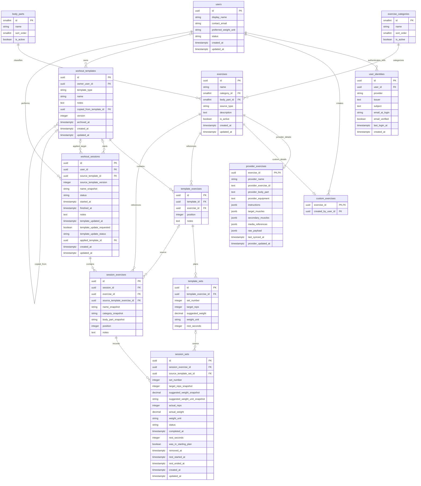

# UNShaken database ER diagram

Design for review; see [design](design.md) for confirmed requirements, technical
proposals, nullability, invariants, and remaining decisions. Mermaid does not
express cross-table ownership, mutually exclusive subtypes, or outcome checks.
The schema remains at 13 tables with no complete template-version subsystem.

